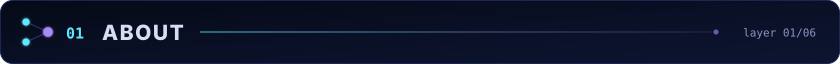
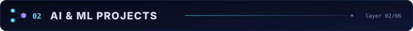
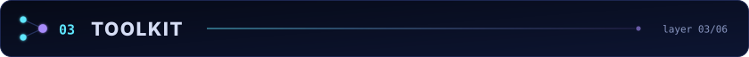
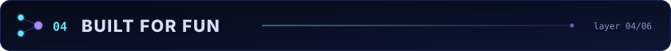
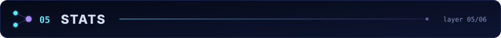
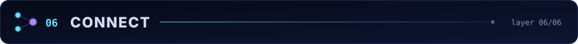

<!--
  Mehhti's GitHub Profile README  ·  Neural edition (v6)
  ───────────────────────────────────────────────────────────────
  Story: AI / ML is the headline. Android apps are the side quest.

  Setup:
  1. Repo name must be exactly "Mehhti", set to Public.
  2. Upload these files into the repo root (next to README.md):
       ai-banner.svg          <- animated neural-network figure (hero)
       ai-divider.svg
       ai-hdr-about.svg
       ai-hdr-research.svg
       ai-hdr-toolkit.svg
       ai-hdr-fun.svg
       ai-hdr-stats.svg
       ai-hdr-connect.svg
     They are all generated by tools/make_ai_svgs.py. To change the text
     or colours, edit the top of that script and re-run it rather than
     hand-editing the SVGs.
  3. The v5 pixel files (pixel-banner.svg, pixel-banner-lite.svg,
     px-divider.svg, hdr-skills/projects/stats/connect.svg) are no longer
     used. Delete them.
  4. The contribution animation (tools/contrib_runner.py +
     .github/workflows/contrib-runner.yml) is unchanged from v5.
  5. If your default branch is "master", replace /main/ with /master/ in
     every raw URL below.

  ── v6 CHANGES ───────────────────────────────────────────────────
  * Order flipped: About → AI & ML projects → Toolkit → Built for fun
    (the Android apps) → Stats → Connect.
  * Banner: a scientific figure of a small CNN
    (input → conv → pool → dense → dense → softmax). A 3×3 kernel slides
    over the input and signals travel through the network one layer at a
    time; the left side shows a training-loss curve. Pure CSS animation,
    stops under prefers-reduced-motion. Dark panel, so it reads the same
    in GitHub's light and dark themes.
  * Section headers read like layers ("layer 01/06").
  * "About" written as a Python class.
  * Toolkit: ML and LLMs first; Python first among languages; Android
    stack moved to a "For fun" row.
  * Typing line uses Fira Code instead of the pixel font.
  * Connect: Kaggle first.

  Palette:
  night #060A17 · navy #0D1532 · badge label #0B1020 · cyan #5EE7FF
  violet #A78BFA · amber #F6C177 · text #D6DEF5 · muted #8A97C2
-->

<!-- ░░ Hero: neural-network figure ░░ -->
<p align="center">
  
</p>

<!-- ░░ Typing line ░░ -->
<p align="center">
  
</p>

<p align="center">
  
  
  
</p>

<p align="center">
  
</p>

<!-- ░░ 01 · ABOUT ░░ -->


```python
class Mehhti:
    focus      = ["Artificial Intelligence", "Machine Learning", "Deep Learning"]
    exploring  = ["Large Language Models", "Computer Vision", "Transfer Learning"]
    toolkit    = ["Python", "TensorFlow", "Keras", "Streamlit"]
    side_quest = "building Android apps, just for fun 📱"

    def __str__(self):
        return "Curious about how models learn, see and reason."
```

<!-- ░░ 02 · AI & ML PROJECTS ░░ -->


<table>
  <tr>
    <td valign="top">
      <h3>🧠 <a href="https://github.com/Mehhti/brain-tumor-detection">Brain Tumor Detection</a></h3>
      <p>
        
        
        
      </p>
      <p>A deep-learning system that flags brain tumors in MRI scans. It reuses a MobileNetV2 backbone through transfer learning, and a Streamlit app validates the input image before it predicts anything. Built for research and learning — not for clinical use.</p>
      <p>
        <code>MRI scan</code> → <code>input validation</code> → <code>MobileNetV2 · transfer learning</code> → <code>prediction</code>
      </p>
      <p>
        
        
        
        
      </p>
    </td>
  </tr>
  <!-- Next ML project: copy the <tr> above and fill it in. -->
</table>

<p align="center">
  
</p>

<!-- ░░ 03 · TOOLKIT ░░ -->


<table>
  <tr>
    <td width="160" valign="middle"><b>🤖 Machine learning</b></td>
    <td valign="middle">
      
      
      
      
      
    </td>
  </tr>
  <tr>
    <td width="160" valign="middle"><b>🧠 LLMs</b></td>
    <td valign="middle">
      
      
    </td>
  </tr>
  <tr>
    <td width="160" valign="middle"><b>💻 Languages</b></td>
    <td valign="middle">
      
      
      
      
      
      
    </td>
  </tr>
  <tr>
    <td width="160" valign="middle"><b>📱 For fun</b></td>
    <td valign="middle">
      
      
      
      
    </td>
  </tr>
</table>

<p align="center">
  
</p>

<!-- ░░ 04 · BUILT FOR FUN ░░ -->


<p>
  When I'm not training models, I build Android apps — just for fun. A few of them grew up and shipped.
  <br>
  
</p>

<table>
  <tr>
    <td width="50%" valign="top">
      <h3>⏰ <a href="https://github.com/Mehhti/Clocki_App">Clocki</a></h3>
      <p></p>
      <p>A daily planner that draws your activities as colored arcs around an analog clock, so a whole day reads at a glance. Ships with a live wallpaper and a Wear OS watch face.</p>
      <p>
        
        
        
      </p>
    </td>
    <td width="50%" valign="top">
      <h3>🧾 <a href="https://myket.ir/app/com.factoryar.app">FactorYar</a></h3>
      <p> </p>
      <p>An invoice assistant for small shops. Pick products, set quantities, and share a clean Persian right-to-left invoice as PDF or Excel, with the store's own name and logo. Product management, VAT and shipping lines, history and monthly totals — all on the device, nothing uploaded.</p>
      <p>
        
        
        
      </p>
    </td>
  </tr>
  <tr>
    <td width="50%" valign="top">
      <h3>🧭 <a href="https://myket.ir/app/ir.careercompass.app">Career Compass</a></h3>
      <p></p>
      <p>A field-of-study and career guide for Iranian high-school students, built on Holland's RIASEC model. A forced-choice quiz maps answers to majors and careers that exist in Iran's system, vocational (honarestan) tracks included.</p>
      <p>
        
        
        
      </p>
    </td>
    <td width="50%" valign="top">
      <h3>🏰 <a href="https://myket.ir/app/com.example.thesecretofmansionofshadows">The Secret of Mansion of Shadows</a></h3>
      <p></p>
      <p>A mystery-themed adventure game — explore the mansion, follow the clues, find the way out.</p>
      <p>
        
        
      </p>
    </td>
  </tr>
</table>

<p align="center">
  
</p>

<!-- ░░ 05 · STATS ░░ -->


<!--
  No github-readme-stats cards on purpose: that shared Vercel server runs
  out of GitHub API quota daily and camo caches its error image for hours.
  shields.io badges + the self-hosted contribution animation need no
  external server you have to maintain. (Setup for the animation: add
  tools/contrib_runner.py and .github/workflows/contrib-runner.yml, then
  Actions → "Generate contribution runner" → Run workflow once.)
-->

<p align="center">
  
  
  
</p>

<p align="center">
  
  
  
  
</p>

<!-- Contribution animation from this repo's own GitHub Action.
     Delete this block if you skip the workflow file. -->
<p align="center">
  
</p>

<p align="center">
  
</p>

<!-- ░░ 06 · CONNECT ░░ -->


<p align="center">
  <a href="https://www.kaggle.com/mehhti">
    
  </a>
  <a href="https://github.com/Mehhti">
    
  </a>
  <a href="mailto:mehdimodares2002@gmail.com">
    
  </a>
</p>

<p align="center">
  <sub>Thanks for stopping by — <code>model.fit(curiosity, epochs=∞)</code></sub>
</p>
